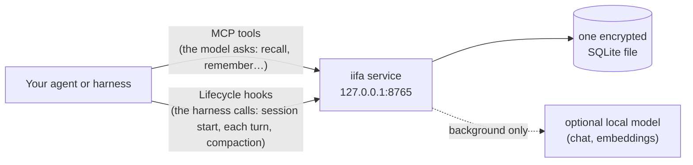

# iifa

> Long-term memory for your AI agent, under a token budget you set.

[](https://github.com/Balidriss/iifa/actions/workflows/ci.yml)
[](LICENSE)
[](pyproject.toml)
[](#status)

iifa is a memory service you run yourself, next to the agent you already use.
It remembers people, projects, places and topics across conversations, notices
when something changes, and gives your agent only what fits in the budget you
set. One encrypted file. No cloud, no external database, no telemetry.

## What it does

- **Never goes over budget.** Ask with 300 tokens, get at most 300 tokens:
  short handles first, details only for the ones your agent opens.
- **Keeps what changed, and when.** "Karim moved to Lyon" closes "Karim lives
  in Paris" instead of overwriting it. You can still ask what was true in
  March.
- **Learns from conversations on its own**, if you give it a local model, and
  only in the background: your agent never waits for it.
- **Treats memory as data, not orders.** Text from a web page or a tool never
  becomes a fact about you by itself, and a stored "ignore your instructions"
  stays a quote.
- **Keeps each fact in the language it was told in**, across scripts:
  Karim, Карим and كريم can be one person.
- **Works without any model.** Add a chat model, then an embeddings model,
  and each step adds something you can name.

## How it fits



There are two ways in. **MCP tools** let the model ask memory itself.
**Lifecycle hooks** let the harness inject memory at the right moments without
the model asking. The integrations below use one or both.

## Quickstart

No model needed. Commands are for bash (on Windows: Git Bash or WSL).

### 1. Create a key and a token

```bash
mkdir -p -m 0700 ~/.config/iifa && chmod 0700 ~/.config/iifa
openssl rand -base64 32 > ~/.config/iifa/db.key   # the database key: lose it, lose the memory
openssl rand -hex 24 > ~/.config/iifa/token       # what your agent (and curl) presents
```

### 2. Start the service with Docker

```bash
git clone https://github.com/Balidriss/iifa && cd iifa
docker build -t iifa .
chmod 0644 ~/.config/iifa/db.key                  # readable by the container, inside your 0700 directory
docker volume create iifa-data
docker run -d --name iifa \
  -e IIFA_HOST=0.0.0.0 -e IIFA_TOKEN="$(cat ~/.config/iifa/token)" \
  -p 127.0.0.1:8765:8765 \
  --mount type=volume,source=iifa-data,target=/data \
  --mount type=bind,source="$HOME/.config/iifa/db.key",target=/run/secrets/iifa_db_key,readonly \
  iifa
```

Why the key is mounted that way, and how to open the port safely:
[docs/docker.md](docs/docker.md).

### …or with pip (Python 3.11–3.13)

```bash
git clone https://github.com/Balidriss/iifa && cd iifa
python -m venv .venv && . .venv/bin/activate      # Windows: .venv\Scripts\activate
pip install .
export IIFA_DB_KEY_FILE=~/.config/iifa/db.key IIFA_DB_PATH=./memory.db
export IIFA_TOKEN="$(cat ~/.config/iifa/token)"
iifa                                              # listens on 127.0.0.1:8765
```

### 3. Try it

```bash
H="Authorization: Bearer $(cat ~/.config/iifa/token)"; J='Content-Type: application/json'

curl -s -H "$H" localhost:8765/v1/health          # {"status": "ok", "tier": 0, ...}

curl -s -H "$H" -H "$J" localhost:8765/v1/remember -d '{"scope": "user:alice",
  "statement": "Karim leads the installation planning of the solar project",
  "node": {"name": "Karim", "kind": "person"}}'

curl -s -H "$H" -H "$J" localhost:8765/v1/recall -d '{"scope": "user:alice/mode:assistant",
  "query": "who works on the solar project?", "budget_tokens": 300}'

curl -s -H "$H" -H "$J" localhost:8765/v1/expand -d '{"scope": "user:alice",
  "ids": ["fact_…"], "level": 2, "budget_tokens": 400}'      # an id from the recall
```

The recall returns **handles**: an id, a title, one line, why it matched, and
what opening it would cost. `used_tokens` is never above `budget_tokens`.
A **scope** such as `user:alice/mode:assistant` says whose memory this is; it
also sees `user:alice` above it. More calls: [docs/api.md](docs/api.md).

To let iifa learn from conversations, point it at a model:
[docs/configuration.md](docs/configuration.md#the-three-common-setups).

## Integrations

| Your agent | How it connects | Guide |
|---|---|---|
| **Claude Code** | a plugin: hooks for every lifecycle moment, plus the MCP tools | [adapters/claude-code](adapters/claude-code/README.md) |
| **Hermes Agent** | a memory provider, standard library only | [adapters/hermes](adapters/hermes/README.md) |
| **opencode** | a TypeScript plugin, no dependency | [adapters/opencode](adapters/opencode/README.md) |
| **OpenAI Agents SDK** | an example to copy: tools plus the profile in the instructions | [adapters/openai-agents](adapters/openai-agents/README.md) |
| **Any MCP client** | MCP over streamable HTTP at `/mcp`, or stdio (`iifa mcp`) | [docs/api.md](docs/api.md#mcp-tools) |
| **Your Python code** | `IifaClient` and `AsyncIifaClient` | [docs/api.md](docs/api.md#python-sdk) |
| **Your own loop** | the five lifecycle moments in under 200 lines | [examples/minimal_agent.py](examples/minimal_agent.py) |

Every integration fails open: if iifa is down or slow, the turn goes on
without memory.

## How it works

**Handles under a budget.** A recall never returns more tokens than you ask
for, and never cuts an item in half. It returns short handles; the agent
expands the few it needs. A session starts with a small **profile block**: the
pinned facts and the most central subjects.
[More](docs/how-it-works.md#recall-under-a-budget-handles-first)

**Background work, on your terms.** Recording a turn only puts it in a queue,
saved in the encrypted file. A worker reads the queue with your model, in one
of three modes: `auto`, `paused` (no model call at all), or `on_demand` (only
inside a run you start, with a budget). No model is ever called while your
agent waits. [More](docs/how-it-works.md#background-work-and-your-models-time)

**The dream.** Now and then, a model can reorganise a scope while nobody
waits: refresh summaries, spot two nodes that are one person, merge repeated
facts. It only proposes from a fixed list of operations; the service checks
each one, keeps a journal, and can undo a whole run. Merges always wait for a
person. [More](docs/how-it-works.md#the-dream)

**Scopes.** Every record belongs to scopes like `user:alice/project:solar`.
A token is bound to its scopes and permissions. Records outside the view are
filtered out before any ranking, so they cannot even change a score.
[More](docs/how-it-works.md#scopes-who-sees-what)

**Provenance.** Every fact points to its source, the quoted words, and who
said them: you, the assistant, or a page. Facts are closed, never
overwritten, so you can ask what was known on any date.
[More](docs/how-it-works.md#provenance-where-every-fact-comes-from)

## Status

**0.1.0a2, pre-alpha.** Everything below is built and tested, but the API may
still change, and the package is not on PyPI yet.

| Area | State |
|---|---|
| Recall under a budget, with no model | built |
| Learning from conversations (needs a chat model) | built; quality depends on the model, see [benchmarks](docs/benchmarks.md) |
| Search by meaning (needs an embeddings model) | built; bge-m3 recommended |
| The dream | built; merges and consolidations wait for review by default |
| Claude Code, Hermes, opencode, Agents SDK | built, tested against a fake service, not yet run inside the harness |
| Docker image | built, checked end to end in CI on `linux/amd64` |
| Platforms | Linux and Windows (tested); macOS expected, untested |

What changed in each version: [CHANGELOG.md](CHANGELOG.md).

## Documentation

| Page | What is in it |
|---|---|
| [How it works](docs/how-it-works.md) | tiers, handles, the background, the write path, the dream, scopes, provenance |
| [Configuration](docs/configuration.md) | environment variables, the TOML file, tokens and permissions, local models |
| [API reference](docs/api.md) | every route, the MCP tools, the Python SDK |
| [Docker](docs/docker.md) | volumes, the key, publishing the port safely |
| [Security](docs/security.md) | what protects the memory, token counting, known limits |
| [Benchmarks](docs/benchmarks.md) | every number, and the command that measured it |
| [Development](docs/development.md) | checks, tests, platforms |
| [SPEC.md](SPEC.md) | the design document, with every rule and its reasons |

## Security

- The database is encrypted; you hold the key, and iifa never generates it.
- The service listens on loopback only, unless you decide otherwise.
- Agents get scope-bound tokens; deleting for good needs its own permission.
- No outgoing connection except to the model endpoints you configure.

Details and known limits: [docs/security.md](docs/security.md).

## License

Apache-2.0. See [LICENSE](LICENSE).
